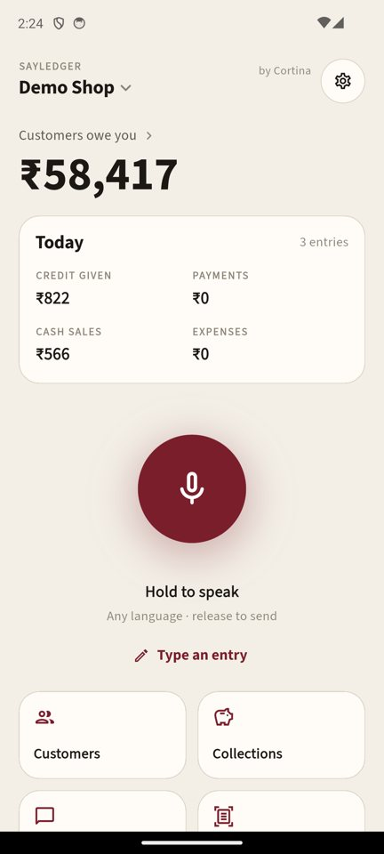
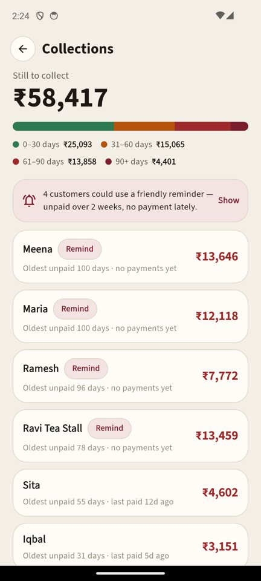
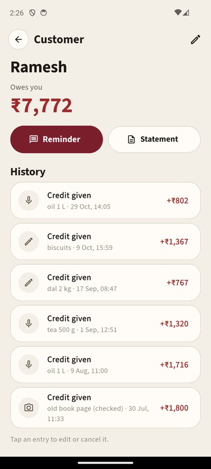
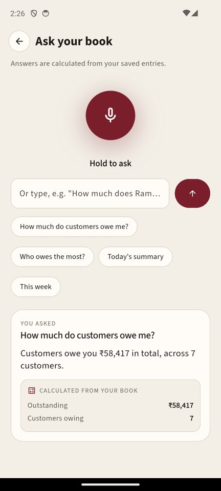
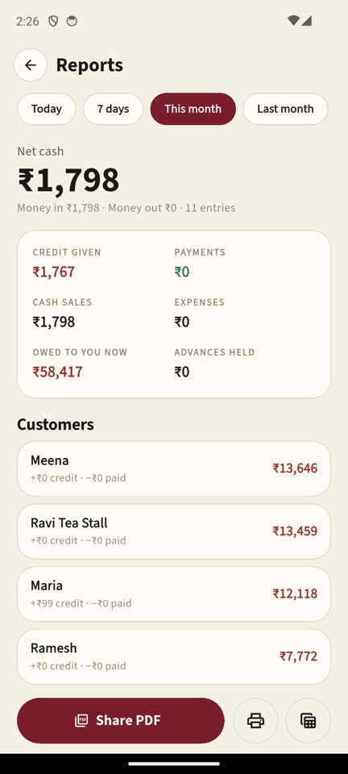
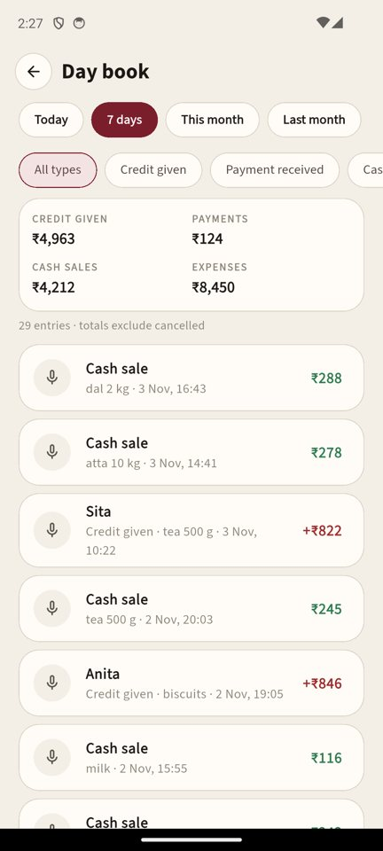
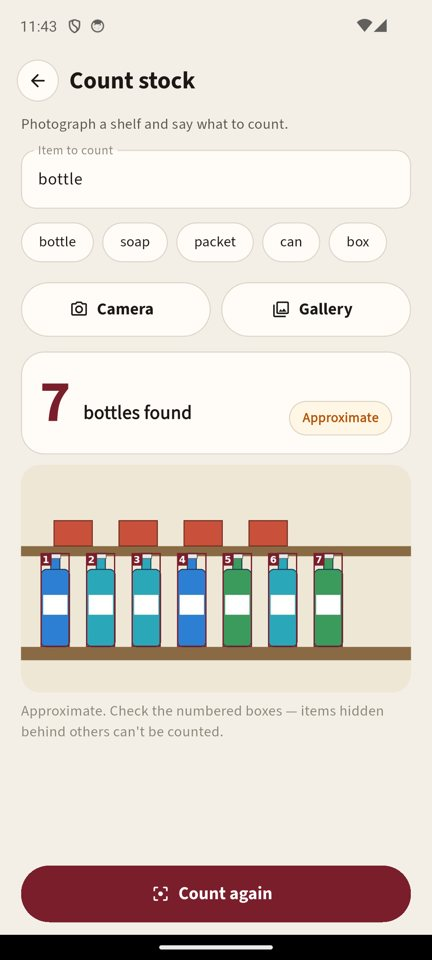

<p align="center"></p>

# SayLedger by Cortina

[](https://github.com/Cortina-Lab/sayledger/actions/workflows/ci.yml)
[](https://github.com/Cortina-Lab/sayledger/releases)

[](LICENSE)

**Say it. It's in the book.**

Hundreds of millions of small shops still keep customer credit ("udhaar", "tab", "fiado") in a
paper notebook. Typing into an app while a customer waits at the counter is too slow, so they
don't — and money is forgotten.

SayLedger is a **voice + vision credit book** for small shops anywhere. The shopkeeper *says*
"Ramesh took 3 kg rice, 450 on credit" in their own language, checks a card, taps **Confirm** —
and it's in the book. They can photograph an old handwritten ledger page, ask their book
questions, see who owes what and for how long, send polite reminders, and share statements as PDF.

Built for the **Meta Global AI Developer Hackathon** (Startup track, theme: *Build for Your World*).

---

## Screenshots

| Home | Collections | Customer | Ask your book |
|---|---|---|---|
|  |  |  |  |

| Reports | Day book | Count stock (SAM 3.1) |
|---|---|---|
|  |  |  |

<sub>Screens show the invented "Demo Shop" data. The app also has a dark theme and USD / any-currency books.</sub>

---

## How Meta's models are used

Every AI step runs on Meta models through the **Meta Model API** (`https://api.meta.ai/v1`).
All maths is done in Python from the database — **the model never calculates a total and never
writes to the book**.

| Feature | Meta model | What the model does | What our code does |
|---|---|---|---|
| Voice entry | `muse-voice-transcribe-1.0` → `muse-spark-1.3` | Speech → text; text → proposed entries (JSON) | Validates JSON, converts amounts to integer minor units, matches customer names, shows editable cards. Saves only on **Confirm** |
| Typed entry | `muse-spark-1.3` | Same extraction from typed text (any language) | Same validation |
| Scan an old ledger page | `muse-spark-1.3` (image input) | Reads handwritten rows; counts rows it can't read as *unreadable* instead of guessing | Low-confidence fields highlighted; page dates kept; nothing saved until reviewed |
| Ask your book | `muse-spark-1.3` | Maps the question to **one intent** from a fixed list (or "none") | Computes every number from the ledger; answer built from a template |
| Payment reminder | `muse-spark-1.3` | Writes a polite message in the chosen language with an `{AMOUNT}` placeholder | Inserts the exact balance; falls back to a fixed template if the model adds any number |
| Count stock | `sam-3.1` (text prompt) | Segments every instance of an item ("bottle") in a shelf photo | Filters by confidence, removes duplicates, counts, draws numbered boxes; labelled *approximate* |

Model calls are rate-limited per book, and `muse-spark-1.3` is called with an explicit
`reasoning_effort` because its `max_tokens` budget includes reasoning tokens.

---

## Features

- **Hold to speak** (16 kHz mono WAV) or **type** an entry — several entries in one sentence.
- **Confirm cards** — "Heard: …", every field editable, doubtful fields highlighted, *New customer* chip.
- **Scan ledger page** — digitise an old notebook page row by row, honestly reporting unreadable rows.
- **Ask your book** — by voice or text; answers show the numbers they came from.
- **Collections** — outstanding money by age (0–30 / 31–60 / 61–90 / 90+ days, payments clear the
  oldest credit first) and who could use a friendly reminder.
- **Reminders** in 8 languages — the shopkeeper edits and sends them via the share sheet; the app never sends anything itself.
- **Customer statement PDF** (opening balance, running balance, closing) — share or print.
- **Reports** for any period — money in / out, net cash, per-customer movement — PDF, print, CSV.
- **Day book** with period and type filters.
- **Edit and cancel** entries — nothing is silently deleted: cancelled entries stay visible and leave
  every total; every add / edit / cancel is in the **Activity log**.
- **Count stock** from a shelf photo.
- **Backup / restore / erase** the whole book.
- **Universal**: India (₹, lakh grouping), USA ($), or any ISO 4217 currency. Speak or type in any
  language; the app UI is English.

---

## Architecture

```
Flutter app (Android)  ──audio / photo / text──▶  FastAPI backend (Python)
   cards, lists, PDFs  ◀───────── JSON ─────────    ├─ meta_client.py  only place that calls Meta
                                                    ├─ agent.py        prompts + strict validation
                                                    ├─ ledger.py       SQLite, ALL maths, audit log
                                                    ├─ stock.py        SAM 3.1 boxes → count + overlay
                                                    └─ books.py        one SQLite file per install
```

- **Privacy by design**: each install gets its own book (a separate SQLite file) opened with a
  random bearer token; only a SHA-256 of the token is stored. No login, no ads, no analytics.
  Logs contain method, path, status and time only — no bodies, tokens or customer data.
- **Money** is stored as integer minor units (paise / cents) plus the shop's currency. Never floats.
- The phone never holds the Meta API key.

---

## Run it

### Backend
```bash
cd backend
python3 -m venv .venv && .venv/bin/pip install -r requirements.txt
cp .env.example .env          # put your Meta Model API key in META_API_KEY
.venv/bin/uvicorn app.main:app --port 8077
.venv/bin/python -m pytest -q # 42 tests, no network needed (also run by CI on every push)
```
Optional: `scripts/phase2_check.py` makes one real call to each Meta model;
`scripts/seed_demo.py data/books/<id>.db` fills a book with invented demo data.

### App
```bash
cd app
adb reverse tcp:8077 tcp:8077   # phone on USB talks to the laptop backend
flutter run                     # or: flutter build apk
```
First launch asks for a shop name and region and creates a private book.
The server address can be changed in **Settings → Server**.

---

## What we tested (honestly)

| | Status |
|---|---|
| Typed entries — English, Hinglish, Hindi (Devanagari), US English (USD) | ✅ tested with the live model |
| Ask — English, Hinglish, Hindi; off-topic questions refused | ✅ tested |
| Reminders — English, Hindi, Spanish; amount always exact | ✅ tested |
| Ledger page — printed-style handwriting with one blurred row (blurred row reported as unreadable) | ✅ tested; real handwriting varies |
| Stock count — synthetic shelf (7 bottles, 4 boxes) | ✅ counted correctly; real shelves are approximate |
| Voice entry with real speech — Hinglish ("Ramesh ne do kilo chawal liye, 180 udhaar") → transcribed in Devanagari → card *Ramesh · credit · ₹180 · 2 kg rice* | ✅ tested (laptop mic, 16 kHz WAV) |
| Other languages | *should* work (the models are multilingual) but are **not yet tested** |

**Demo data**: the "Demo Shop" in the video uses invented customers and amounts
(`scripts/seed_demo.py`). No real customer data is in this repo.

---

## What SayLedger is not

A credit book, not accounting or tax software: no tax filing, invoices, credit scores or
lending. Readings from voice and photos are approximate — **the shopkeeper confirms every entry**.

## Built during the hackathon

Everything in this repository was built during the hackathon (Oct 26 – Nov 4 2026).
Our team's earlier shop app (Cortina AI Vyapar) is the experience behind the idea; none of its
code, data or design is used here. Code was written with AI coding assistance (Claude); every AI
feature inside the app runs on Meta models.

## Roadmap

Real-time voice via streaming transcription · offline entry queue · cloud sync across devices ·
WhatsApp deep links for reminders · on-device open-weights extraction (Muse Spark Open).

---

Made by **Lexcore Enterprises** · Cortina
